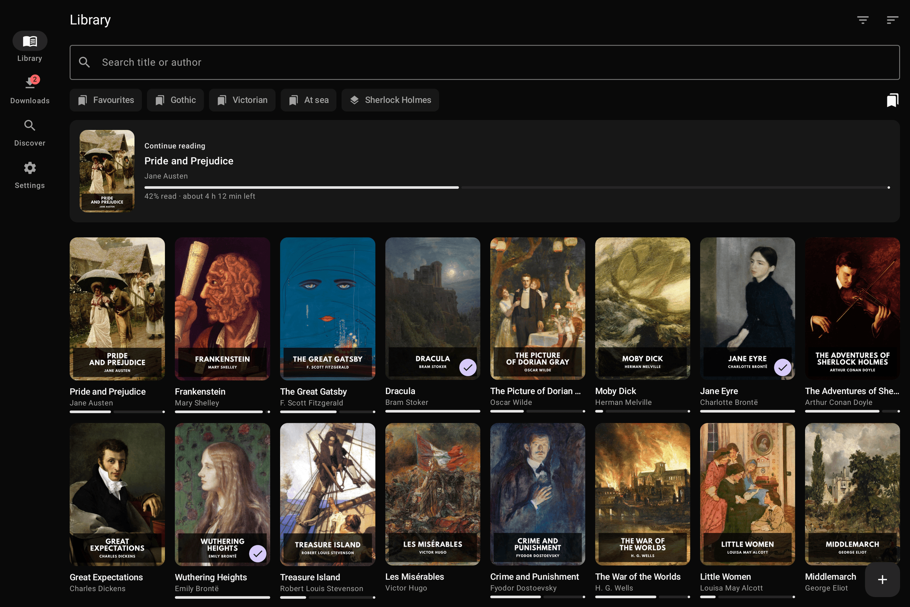
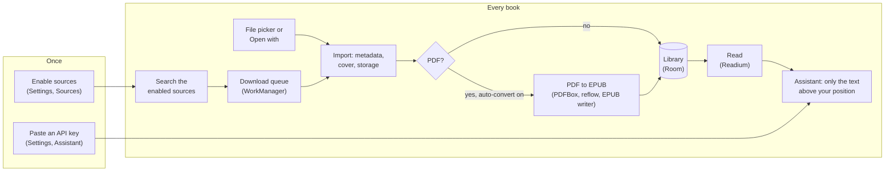

<p align="center">
  <picture>
    <source media="(prefers-color-scheme: dark)" srcset="artwork/svg/readana-horizontal-dark.svg">
    
  </picture>
</p>

<p align="center">
  <strong>A personal e-reader for the Xiaomi Pad 8: find books, convert PDFs to EPUB, and read with an assistant that never spoils what comes next.</strong>
</p>

<p align="center">
  <a href="#quick-start"><strong>Build and install</strong></a>
  &middot;
  <a href="#usage">Usage</a>
  &middot;
  <a href="docs/ARCHITECTURE.md">Documentation</a>
  &middot;
  <a href="docs/ROADMAP.md">Roadmap</a>
  &middot;
  <a href="CHANGELOG.md">Changelog</a>
</p>

<p align="center">
  <a href="https://github.com/TBLgGamin/readana/actions/workflows/ci.yml"></a>
  <a href="LICENSE"></a>
  <a href="#quick-start"></a>
  <a href="gradle/libs.versions.toml"></a>
</p>

---

Readana searches several book sources at once, downloads the file in the background, turns a PDF
into a reflowable EPUB when you want that, keeps everything in a library on the tablet, and opens it
in a reader with the controls a dedicated e-reader has. *You search "Circe", pick the copy you want
and it lands in your library as an EPUB. A month later you open the book, ask "Where was I?", and
the recap stops at the page you reached.*

It is a native Android app (Kotlin, Jetpack Compose) built for the **Xiaomi Pad 8** (Android 16,
HyperOS 3, 11.2" 3:2 screen) that runs on Android 10 and later. The library, your progress and your
notes live in the app's own storage on the device. The reading assistant uses your own API key with
the provider you choose. Milestones M0 to M6 of the [roadmap](docs/ROADMAP.md) are done; no release
is tagged yet, so you build the APK yourself.

<p align="center"></p>

## Table of contents

- [Features](#features)
- [Quick start](#quick-start)
- [Usage](#usage)
- [Configuration](#configuration)
- [How it works](#how-it-works)
- [Development](#development)
- [Contributing](#contributing)
- [Security](#security)
- [Acknowledgements](#acknowledgements)
- [License](#license)

## Features

- **One search over many sources.** A single search box fans out to every enabled source: Open
  Library (Internet Archive scans), arXiv preprints, Anna's Archive and any OPDS catalog you add.
  Copies of the same book are grouped, and a picker lists every copy by language, format, size and
  year.
- **OPDS catalogs.** Standard Ebooks, the Directory of Open Access Books and Feedbooks are one tap,
  or paste a feed address, including your own Calibre-Web. Catalogs can be browsed shelf by shelf as
  well as searched.
- **Background downloads.** WorkManager and a foreground service carry downloads through HyperOS's
  aggressive process killing. Downloads can be paused and resumed from the byte they stopped on, and
  each one shows its steps, speed and time left.
- **PDF to EPUB on the device.** PDFBox text extraction, layout heuristics (headers and footers,
  paragraphs, hyphenation, headings, two-column detection, figures) and a valid EPUB 3, validated
  with epubcheck in tests. The original PDF is always kept.
- **A persistent library.** Room database plus files in app storage (or a folder you choose through
  the system folder picker), covers extracted on import, reading progress, sort, filter, search,
  shelves and series. Import from the file picker or another app's "Open with".
- **A reader with the controls you expect.** Readium navigator for EPUB and PDF: paginated or
  scrolled, tap zones and swipe, font, size, margins, line height and paragraph spacing, themes
  (system, light, sepia, dark, black), progress slider, contents, bookmarks, in-book search,
  highlights and notes with Markdown export, and two-page spreads in landscape. Settings belong to
  the book once you change them while it is open.
- **Time left.** Your reading pace, learned from your own sessions, gives "About 8 min left in this
  chapter" and the time left in the book. Nothing is promised until there is enough reading to know.
- **A reading assistant.** Ask about a passage, have it explained, or get a recap after time away,
  with your own API key for Anthropic, OpenAI, Gemini, OpenRouter, DeepSeek or any OpenAI-compatible
  server. The model only ever sees the part of the book you have already read, so it cannot spoil
  what comes next.
- **Define and read aloud.** Define looks a word up on Wiktionary, and Listen reads the book aloud
  with the page following the voice.
- **Stylus support.** Palm rejection ignores fingers while the pen is in use; a pen drag highlights
  text or draws ink on the page.
- **Quality gates.** Spotless and ktlint, detekt, Android Lint with warnings as errors, Konsist
  architecture tests, screenshot tests that need no emulator, and a committed baseline profile.

## Quick start

### Prerequisites

- **JDK 17+** (any vendor; 21 in CI).
- The **Android SDK** with *platform 37* (compileSdk) and *build-tools 36.0.0*. Android Studio
  installs these, or use `sdkmanager`. Point Gradle at the SDK with `local.properties`
  (`sdk.dir=...`) or `ANDROID_HOME`.
- An Android 10 (API 29) or later device or emulator. The Xiaomi Pad 8 is the target; `targetSdk` is
  36.

### Installation

No release is tagged yet, so build from source. Releases will attach a signed APK
([docs/RELEASING.md](docs/RELEASING.md)).

```bash
git clone https://github.com/TBLgGamin/readana.git && cd readana
./gradlew assembleDebug                     # first run downloads ~1 GB of dependencies
adb install app/build/outputs/apk/debug/app-debug.apk
```

Device setup for the Pad 8 (developer options, the "Install via USB" Mi-account gotcha, battery
restrictions): [docs/DEVICE.md](docs/DEVICE.md).

The everyday loop, against the tablet or an emulator, is just adb:

```bash
./gradlew :app:installDebug                                       # build + install in one step
adb shell am start -n dev.readana.debug/dev.readana.MainActivity
adb logcat -v color -s Readana:V AndroidRuntime:E                 # Ctrl+C when done
```

Debug builds install as `dev.readana.debug`, so they sit next to a release build rather than
replacing it.

### First run

1. Open **Library** and add a book with **Add books**, or use "Open with Readana" from another app.
   EPUB and PDF are supported.
2. Open **Discover** and search. Open Library is on by default; arXiv and Anna's Archive are off
   until you turn them on in **Settings, Sources**, where you can also add OPDS catalogs.
3. For the assistant, open **Settings, Assistant**, pick a provider and paste a key.
4. On HyperOS, set Settings, Apps, Readana, Battery saver to **No restrictions** so downloads and
   conversions are not killed in the background ([docs/DEVICE.md](docs/DEVICE.md)).

### Uninstall and data

Uninstalling removes the app's database and files, including the library. Where the data lives is
listed under [Configuration](#data-locations).

### Running without a tablet

The SDK's own emulator is enough and does not need Android Studio. Install `emulator` and
`system-images;android-36;google_apis;x86_64` with `sdkmanager`, then build an AVD with the Pad 8's
3:2 screen:

```bash
avdmanager create avd -n pad8 -k "system-images;android-36;google_apis;x86_64" -d medium_tablet
# then in <avd>/config.ini: hw.lcd.width=3200, hw.lcd.height=2136, hw.lcd.density=400
emulator -avd pad8 -gpu host
```

That yields 1280 x 854 dp, the same window size classes as the real device. Handy while checking
adaptive layouts:

```bash
adb shell cmd window user-rotation lock 1   # portrait (854 dp); 0 = landscape, free = auto
adb shell wm size 1080x2400                 # pretend it's a phone; `wm size reset` to undo
adb shell wm density 320                    # sweep breakpoints without booting another AVD
adb shell cmd uimode night yes              # dark theme
```

Set `ANDROID_AVD_HOME` before creating AVDs if you care where the multi-gigabyte disk images land;
the emulator otherwise writes them under `~/.android/avd` no matter where the SDK lives. The
emulator is AOSP, so it will not reproduce the HyperOS behaviour in
[docs/DEVICE.md](docs/DEVICE.md): background killing, Workstation mode, the Focus Pen.

## Usage

### The app

A navigation bar (a rail on wide windows) switches between four pages. The reader opens over them
and hides the navigation.

| Page | What it does |
|---|---|
| **Library** | Your books as a grid. A card at the top continues the book you were reading. Search, sort (recent, title, author), filter (All, Reading, Unread, Finished), shelves you make and series Readana finds in the metadata. Holding a shelf turns the grid into a picker for it. A book's details sheet shows its metadata and notes, converts a PDF again, and can mark it finished. |
| **Downloads** | The queue as cards with title, author, format and size, a bar while it moves, speed and time left, and the steps each download goes through (waiting, finding the file, downloading, converting). Pause, resume, retry and cancel; filters for All, In progress and Needs you. The navigation item wears a badge while anything is queued. |
| **Discover** | One search over the enabled sources, with a popular shelf from Open Library, shelves for the catalogs you added and paged results. Holding a result opens its details; the download button queues it. When a source is answering a browser check, Discover says so and offers to open the page. |
| **In-app browser** | Opens when a source needs a real browser (a check to pass, a wait-list, a spent allowance). The file it ends up downloading is captured into the queue. |
| **Reader** | Opens any book in the library. Bottom bar with progress, time left, contents, settings, conversations with the assistant and Listen. See below. |
| **Settings** | Five tabs: Reading (defaults for every book), Sources, Assistant, Files (PDF conversion and the library folder) and About (the version). |

In the reader:

| Control | What it does |
|---|---|
| Tap zones and swipe | Turn pages; paginated or scrolled; two columns or pages in landscape. Volume keys can turn pages too (off by default). |
| Reader settings sheet | Font, size, line height, paragraph spacing, margins, theme, columns, keep screen on. A change made with a book open becomes that book's own copy. |
| Contents sheet | Three tabs: Contents, Bookmarks and Notes. Notes lists every marked passage in reading order and jumps back to it. |
| Selection menu | Highlight, Note, Ask, Explain and Define next to the system's copy and share. A highlight's colour, note and deletion live in its editor, opened by tapping it. |
| Assistant | **Ask about this book**, **Where was I?** and every conversation held about the book. A book reopened after a few days offers a recap. |
| Listen | Reads aloud; a floating toolbar has previous, play, next, speed and stop, and the page follows the voice. Reading stops when you leave the reader. |
| Pen | While the pen touches or hovers, fingers are ignored. A drag highlights or draws ink, per Settings. Ink on a reflowing book is shown faintly when the font changes. |

### Sources

Sources declare their own settings, and the Sources page renders them, so a new source needs no UI
of its own.

| Source | On by default | What it finds | Settings |
|---|---|---|---|
| Open Library | yes | Internet Archive scans that can actually be downloaded; borrowable (lending-only) items are not listed. Prefers the EPUB over the scanned PDF when both exist. | none |
| arXiv | no | Open-access preprints, converted from PDF. | Categories, e.g. `cs.AI, cs.LG`; empty searches all of it |
| Anna's Archive | no | A shadow-library catalogue. Free downloads try Library Genesis first, then Anna's own partner servers, and the in-app browser last. A membership key unlocks fast downloads. | Mirrors, Membership key |
| OPDS catalogs | yes, once added | OPDS 1.2 and 2.0 feeds, browsed and searched. | Username and password, for catalogs that need them |

### A note on sources and copyright

Readana is a reader and a download manager; it does not host content. Project Gutenberg serves
public-domain books; its source module is built but not yet registered in the app. Anna's Archive
indexes shadow libraries, and downloading copyrighted works without permission is illegal in most
jurisdictions (its domains are also blocked by several ISPs, including in the Netherlands). The
Anna's Archive source is off until you configure it, the app shows this notice in Settings, and what
you download is your responsibility.

## Configuration

Everything is set in the app; there are no environment variables. Settings are stored in DataStore.

### Reading defaults

Settings, Reading. Once you change something while a book is open, that book keeps its own copy.

| Setting | Default | Purpose |
|---|---|---|
| Font | Publisher | Publisher, Serif, Sans serif or Monospace. |
| Text size | 1.0 (0.6 to 2.5) | Scale of the font. |
| Theme | System | System, Light, Sepia, Dark or Black. |
| Line height | 1.4 (1.0 to 2.2) | Space between lines. |
| Paragraph spacing | 0.6 em (0 to 2) | A gap between paragraphs instead of the publisher's indent; 0 gives the publisher's styling back. |
| Page margins | 1.0 (0 to 3) | Margins around the text. |
| Page turning | Paginated | Paginated or Scrolled. |
| Columns | Auto | Auto adapts reflowable text to the window and keeps fixed-layout books such as comics at one page; One or Two force it. |
| Tap to turn pages | on | Tap zones. |
| Volume keys turn pages | off | Page turning with the volume buttons. |
| Keep screen on | on | Screen stays awake while reading. |
| Palm rejection | on | Ignore fingers while the pen is in use. |
| Pen mode | Highlight | Off, Highlight or Ink: what a pen drag does. |
| Reading voice speed | 1.0 (0.5 to 3.0) | Speed of Listen; a preference of yours, not of the book. |

### Files

Settings, Files.

| Setting | Default | Purpose |
|---|---|---|
| Convert PDFs automatically | on | Convert as PDFs arrive; the original file is kept either way. |
| Remove headers and footers | on | Drop repeated running heads and page numbers. |
| Heading sensitivity | Balanced | Conservative, Balanced or Aggressive: how eager the converter is to call a line a heading. |
| Extract images | on | Put figures into the EPUB. |
| Library folder | none | A folder you pick; without one, books go to app-specific storage. |

### Assistant

Settings, Assistant. Built-in providers come preconfigured: paste a key, fetch the model list, test
the connection. A custom OpenAI-compatible endpoint (Ollama, LM Studio, Groq, Mistral, a private
gateway) can be added by hand and needs no key.

| Provider | Default model | Default base URL |
|---|---|---|
| Anthropic | `claude-sonnet-5` | `https://api.anthropic.com` |
| OpenAI | `gpt-5.6-luna` | `https://api.openai.com/v1` |
| Google Gemini | `gemini-3.6-flash` | `https://generativelanguage.googleapis.com/v1beta/openai` |
| OpenRouter | `anthropic/claude-sonnet-5` | `https://openrouter.ai/api/v1` |
| DeepSeek | `deepseek-v4-flash` | `https://api.deepseek.com/v1` |
| Custom | none | yours |

| Setting | Default | Purpose |
|---|---|---|
| Context size | Medium | How much already-read text goes with a question: Small 60,000 characters, Medium 240,000, Large 800,000, Whole (everything read so far). The text is always cut at your reading position. |
| Recap | on | Offer "Where was I?" when a book is reopened after a while. |
| Recap after | 3 days (1 to 14) | How long an absence earns a recap. |
| Pictures from the web | on | An answer may ask for a picture of something it mentions; Readana looks it up on Wikipedia and the model never sees the result. |

API keys are stored in app-private storage and never logged.

### Data locations

| What | Where |
|---|---|
| Books | `getExternalFilesDir("books")` (app-specific external storage, `filesDir/books` if that is unavailable), or the library folder you picked |
| Covers | `filesDir/covers/<id>.png` |
| Downloads in progress | `filesDir/downloads/<job>.part` |
| Metadata, progress, bookmarks, highlights, conversations, shelves | Room database `readana.db` |
| Settings | DataStore file `readana_settings` |
| Notes exports | `cacheDir/exports`, handed to the share sheet |

## How it works

A search goes to every enabled `BookSource` in parallel and the results are merged. A download is a
WorkManager job under a foreground service: it works out the real file link, streams to a `.part`
file, resumes with a Range request and hands the file to the same importer that serves the file
picker. The importer reads title, authors, language and cover from the original file, skips
duplicates by title and size, stores the file and writes the library row. A PDF then goes through
the converter, one book at a time because PDFBox plus bitmap decoding is memory-hungry. The reader
opens the publication with Readium, and the assistant builds its context by walking the book
backwards from the page on screen, so unread text is never sent.



The app is a thin shell over independent feature modules, shared core modules, and two groups of
pure-Kotlin modules: `engine` for document processing and `source` for where books come from. The
module graph, every data flow above in detail, navigation, error handling and the testing strategy
are in [docs/ARCHITECTURE.md](docs/ARCHITECTURE.md); the "why" behind the stack is in the
[decision records](docs/adr/), and what was evaluated is in [docs/RESEARCH.md](docs/RESEARCH.md).
Download behaviour is in [ADR 0010](docs/adr/0010-download-pipeline.md), conversion in
[ADR 0003](docs/adr/0003-on-device-pdf-to-epub.md), and the assistant in
[ADR 0014](docs/adr/0014-provider-agnostic-reading-assistant.md).

## Development

You need the same prerequisites as the [quick start](#prerequisites). Device notes for the Pad 8 are
in [docs/DEVICE.md](docs/DEVICE.md).

```bash
git clone https://github.com/TBLgGamin/readana.git && cd readana
./gradlew assembleDebug                     # APK in app/build/outputs/apk/debug/
pre-commit install --hook-type pre-commit --hook-type pre-push   # optional local hooks
```

| Check | Command |
|---|---|
| Build the APK | `./gradlew assembleDebug` |
| Format (Kotlin, Gradle scripts, Markdown, YAML, XML; ktlint, Android Studio style) | `./gradlew spotlessApply` |
| Static analysis (config in `config/detekt/detekt.yml`) | `./gradlew detekt` |
| Android Lint over every module; warnings fail the build | `./gradlew :app:lintDebug` |
| Unit tests, screenshot tests included (no emulator needed) | `./gradlew testDebugUnitTest test` |
| Accept the current look as the new screenshot goldens | `./gradlew testDebugUnitTest -PrecordScreenshots=true` |
| One module | `./gradlew :engine:reflow:test` |
| Regenerate the startup profile (needs the tablet attached) | `./gradlew :app:generateBaselineProfile` |
| Everything above | `./gradlew check` |

CI runs on every push to `main` and on pull requests, on JDK 21: `spotlessCheck`, `detekt`,
`:app:lintDebug`, the unit tests and `:app:assembleDebug`, and uploads the debug APK. The optional
pre-commit hooks ([`.pre-commit-config.yaml`](.pre-commit-config.yaml)) run Spotless on Kotlin files
at commit and detekt at push. In a Claude Code session, repository hooks run `spotlessApply` at the
end of each turn, check each edited Kotlin file against the layering rules, and refuse a `git
commit` unless the message is a Conventional Commit and `CHANGELOG.md` is staged with code changes.

Releases are a tag. `vX.Y.Z` runs the same gates, builds a signed APK and publishes it with the
changelog section as release notes and the ProGuard `mapping.txt` attached. `versionName` comes from
the tag and `versionCode` is derived from it, so never edit them by hand. Without the signing
secrets the APK is debug-signed. A manual run of the Release workflow is a dry run that publishes
nothing. See [docs/RELEASING.md](docs/RELEASING.md).

Conventions that are easy to get wrong are in [CLAUDE.md](CLAUDE.md): AGP 9's built-in Kotlin, one
`build.gradle.kts` per module applying a convention plugin, `AppResult` across module boundaries,
Navigation 3 keys registered in `ReadanaNavigation.kt`, prefixed resources and no hard-coded UI
strings. Module rules, enforced by Konsist tests in `app/src/test`: features never import each other;
`core/model`, `core/common`, `core/testing`, `engine/*`, `source/*` and `ai/client` never import
Android; sources, engines and the AI client never depend on the data layer.

Adding a book source is one pure-Kotlin module under `source/` that implements `BookSource`, a
Ktor `MockEngine` test with fixtures, and an `@IntoSet` provider in
`core/data/.../di/SourcesModule.kt`; the source declares its own settings, so no UI changes.

### Stack

| Concern | Choice |
|---|---|
| Language and UI | Kotlin 2.4, Jetpack Compose (BOM 2026.08), Material 3 Expressive, adaptive layouts |
| Build | Gradle 9.7 (wrapper, checksum-pinned), AGP 9.3 with built-in Kotlin, convention plugins in `build-logic/`, version catalog |
| Architecture | Multi-module (app / feature / core / engine / source), Hilt, Navigation 3, unidirectional state |
| Reading engine | [Readium Kotlin Toolkit](https://github.com/readium/kotlin-toolkit) 3.3 (BSD-3) |
| PDF text | [PDFBox-Android](https://github.com/TomRoush/PdfBox-Android) (Apache-2.0) plus the project's own reflow engine |
| Persistence | Room 2.8, DataStore Preferences |
| Networking | Ktor 3 (OkHttp engine), kotlinx.serialization, jsoup |
| Quality | Spotless + ktlint (+ compose rules), detekt 2, Android Lint, Konsist, Dependabot, GitHub Actions; see [ADR 0005](docs/adr/0005-quality-tooling.md) |

Versions are pinned in [`gradle/libs.versions.toml`](gradle/libs.versions.toml) and kept current by
Dependabot.

### Repository layout

```
app/                      Android application: Hilt root, MainActivity, Navigation 3 host, adaptive nav
benchmark/                Macrobenchmark and baseline profile generator
build-logic/convention/   Gradle convention plugins (readana.android.*, readana.jvm.library, readana.hilt, ...)
config/                   detekt, lint and compose-compiler configuration shared by all modules
core/common               Result/AppError types, coroutine qualifiers            (pure Kotlin)
core/model                Domain models: Book, ReaderSettings, DownloadJob, ...   (pure Kotlin)
core/data                 Room, DataStore, repositories, Hilt modules, source registry, import/download/conversion pipelines
core/designsystem         Theme, icons, shared composables
core/testing              Test rules and fakes                                  (pure Kotlin)
engine/epub               EPUB 3 writer, validated with epubcheck               (pure Kotlin)
engine/reflow             PDF layout to paragraphs/headings heuristics          (pure Kotlin)
engine/pdf2epub           PDFBox-Android text extraction + converter facade
source/api                BookSource interface, search/download models          (pure Kotlin)
source/annas              Anna's Archive: HTML search, member API, mirror failover (pure Kotlin)
source/opds               OPDS 1.2 and 2.0 catalogs and the preset list         (pure Kotlin)
source/openlibrary        Open Library search, Internet Archive downloads       (pure Kotlin)
source/arxiv              arXiv preprints                                       (pure Kotlin)
source/trending           Open Library trending feed for Discover's popular shelf (pure Kotlin)
source/gutenberg          Project Gutenberg via Gutendex; built, not registered (pure Kotlin)
ai/client                 LLM clients (Anthropic + OpenAI-compatible), spoiler-safe context builder (pure Kotlin)
feature/library|downloads|discover|browser|reader|settings   Compose screens + ViewModels + nav keys
artwork/                  Logo kit and launcher-icon masters
scripts/                  Release-notes generator, Gradle wrapper helper, Claude Code hooks
docs/                     Architecture, device notes, research, roadmap, releasing, ADRs
```

## Contributing

Issues and pull requests are welcome. Start with [CONTRIBUTING.md](CONTRIBUTING.md) and the
[Code of Conduct](CODE_OF_CONDUCT.md). Use the issue templates, and never attach copyrighted books;
describe the file instead. User-visible changes go in [CHANGELOG.md](CHANGELOG.md) under
*Unreleased*.

## Security

Report vulnerabilities privately as described in [SECURITY.md](SECURITY.md), not in public issues.

## Acknowledgements

- [Readium Kotlin Toolkit](https://github.com/readium/kotlin-toolkit), the EPUB and PDF navigators (BSD-3)
- [PDFBox-Android](https://github.com/TomRoush/PdfBox-Android), PDF text extraction (Apache-2.0)
- [epubcheck](https://github.com/w3c/epubcheck), which validates the converter's EPUBs in tests (BSD-3)
- [Outfit](https://github.com/Outfitio/Outfit-Fonts), the wordmark typeface, under the SIL Open Font License 1.1
- [Standard Ebooks](https://standardebooks.org/about), whose public-domain cover art fills the library screenshot
- [Open Library](https://openlibrary.org), the [Internet Archive](https://archive.org),
  [arXiv](https://arxiv.org), [Standard Ebooks](https://standardebooks.org),
  [Wiktionary](https://www.wiktionary.org) and [Wikipedia](https://www.wikipedia.org), whose
  open data and catalogs the app reads

**Trademarks.** Xiaomi, Xiaomi Pad, HyperOS, Anna's Archive, Project Gutenberg, Open Library,
Internet Archive, arXiv, Calibre-Web, Anthropic, OpenAI, Google Gemini, OpenRouter, DeepSeek and
every other product or service named here belong to their owners. Readana uses the names only to
identify what it works with, is independent of these companies and projects, and is not endorsed or
sponsored by them.

## License

[MIT](LICENSE) © 2026 TBLgGamin.
Third-party components keep their own licences (Readium BSD-3, PDFBox Apache-2.0, epubcheck BSD-3).
