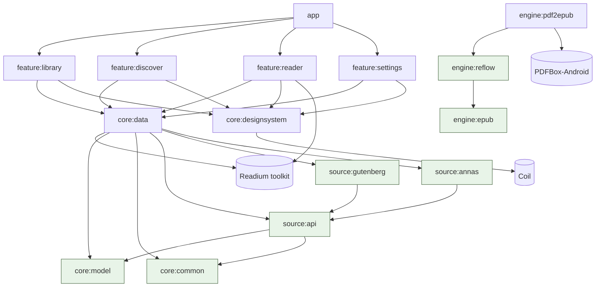

# Architecture

Readana follows the layering of Google's *Now in Android* reference app, trimmed for a solo
project: a thin `app` shell, independent `feature` modules, shared `core` modules, and two groups
that are unique to this app — `engine` (document processing) and `source` (where books come from).

## Module graph



Green nodes are pure Kotlin/JVM modules: no Android dependency, millisecond unit tests, no Robolectric.

| Group | Responsibility | Android? |
|-------|----------------|----------|
| `app` | `ReadanaApplication` (Hilt root), `MainActivity` (FragmentActivity for Readium), `ReadanaApp` (adaptive nav + `NavDisplay`), Konsist tests | yes |
| `feature/*` | One screen family each: `XxxKey` (NavKey), `xxxEntry()` (entry provider), `XxxRoute` (wires ViewModel), `XxxScreen` (stateless UI), `XxxViewModel` | yes |
| `core/data` | Room (`books`, `bookmarks`, `highlights`, `downloads`), DataStore (`SettingsKeys`), repositories, `BookSourceRegistry`, `ReadiumPublicationOpener`, the import pipeline (`BookStorage`, `BookImporter`, `BookImportManager`), the download pipeline (`BookDownloadManager`, `BookDownloader`, `DownloadWorker`), the conversion pipeline (`BookConverter`, `ConversionManager`), all Hilt modules | yes |
| `core/designsystem` | `ReadanaTheme` (Material 3 Expressive), `ReadanaIcons`, `EmptyState`, `LoadingState`, `BookCover` (Coil) | yes |
| `core/model` | `Book`, `BookFormat`, `ReadingProgress`, `Bookmark`, `Highlight`, `ReaderSettings`, `SourceSettings`, `ConversionSettings`, `ConversionInfo`, `DownloadJob`, `BrowserDownload` | no |
| `core/common` | `AppResult`/`AppError`, `@Dispatcher`/`@ApplicationScope`, `suspendRunCatching`, `VolumeKeyRelay` | no |
| `core/testing` | `MainDispatcherRule`, `FakeBookSource` | no |
| `source/api` | `BookSource`, `SearchQuery/Page/Result`, `DownloadRequest`, `DownloadQuota`, `BrowserLogin`, `FileNames` | no |
| `source/gutenberg` | Gutendex JSON client | no |
| `source/annas` | HTML search parser, member fast-download API, `MirrorResolver` | no |
| `engine/epub` | `EpubBook` model, `NavEntry`, `EpubWriter` (EPUB 3.3, epubcheck-validated) | no |
| `engine/reflow` | `PageContent`/`PageText` models, `ReadingOrder` (column detection), `ReflowEngine` heuristics, `EpubAssembler` | no |
| `engine/pdf2epub` | `PdfBoxContentExtractor` (text, figures, outline), `PageImageCollector`, `PdfToEpubConverter` | yes (PDFBox needs a Context) |

## Data flow

### Import → library (M1)

```
File picker / "Open with Readana" intent ──▶ BookImportManager.enqueue(uris)   (application scope)
                                                   ▼
                                         BookImporter.import(uri)
                                                   │ BookMetadataExtractor (Readium): title,
                                                   │ authors, language, cover — from the original
                                                   │ file, before anything is copied
                                                   │ duplicate by (title, size)? ──▶ report, no copy
                                                   ▼
                                         BookStorage.store()  ──▶ app storage or SAF folder
                                         BookStorage.writeCover() ──▶ filesDir/covers/<id>.png
                                                   ▼
                                         LibraryRepository.upsert(Book) ──▶ Room ──▶ Library (Flow)
```

### Discover → download → library (M3)

```
DiscoverViewModel ── SearchQuery ──▶ BookSourceRegistry ──▶ each BookSource.search()   (parallel, merged)
      │
      └─ download(result) ──▶ BookDownloadManager.enqueue()
                 │ already in the library, or already queued for this record? ──▶ report, nothing queued
                 │ source.resolveDownload() ──▶ DownloadRequest (+ remaining quota)
                 │
                 ├─ requiresBrowser / quota spent ──▶ feature:browser WebView
                 │        │ posts the membership key to /account/ (Anna's login IS the key)
                 │        └─ DownloadListener ──▶ enqueueCaptured(url + cookies)  ──┐
                 │                                                                  │
                 └─ direct link ──▶ downloads row + unique work ────────────────────┤
                                                                                    ▼
                          DownloadWorker (WorkManager, dataSync foreground notification)
                                   │ BookDownloader streams to filesDir/downloads/<job>.part
                                   │ resumes with Range; re-resolves an expired link once
                                   ▼
                          BookImporter.import(part, BookOrigin)  ──▶ the M1 pipeline above
                                   ▼
                          downloads row Completed ──▶ Library queue offers "Read"
```

### PDF → EPUB (M4)

Runs after an import or a download whose file turned out to be a PDF, and on demand from the book's
details sheet. One book at a time: PDFBox plus bitmap decoding is memory-hungry (ADR 0011).

```
ConversionManager (application scope, one job at a time) ──▶ BookConverter
        │                                                          │ reads the kept original PDF
        ▼                                                          ▼
   progress per book                            PdfBoxContentExtractor  ── text + figures + outline
   (Library strip)                                                 ▼
                                        ReflowEngine ── ReadingOrder: two-column detection, figures
                                                     ── paragraphs, hyphen repair, headings
                                                                   ▼
                                        EpubAssembler ── chapters from the PDF outline when it maps,
                                                         else from headings; nested nav; image
                                                         resources deduped by content
                                                                   ▼
                                        EpubWriter ──▶ .epub ──▶ BookStorage
                                                                   ▼
                    one library row: format EPUB, file_uri the EPUB, original_file_uri the PDF,
                    progress cleared, report stored for the details sheet
```

### Read (M2)

`ReaderKey(bookId)` → `ReaderViewModel.open()` → `ReaderSessionFactory` →
`ReadiumPublicationOpener` (AssetRetriever + PublicationOpener, pdfium for PDFs) → `Publication` →
a `ReaderSession` holding the navigator's `FragmentFactory`, the table of contents and the position
list. `ReaderNavigatorHostFragment` owns a child fragment manager whose factory is set before
`super.onCreate`, which is what lets Readium's `EpubNavigatorFragment` (and
`PdfNavigatorFragment`) be restored after a configuration change; Compose hosts that host through
`AndroidFragment`. Reader settings from DataStore are mapped to Readium `EpubPreferences` /
`PdfiumPreferences` and submitted on every change. The current `Locator` flows back to the
ViewModel, which persists it (debounced) as JSON plus a fraction, and drives the progress slider,
bookmarks and highlight decorations.

## Cross-cutting decisions

- **State**: ViewModels expose a single `StateFlow<UiState>` (sealed interfaces); screens are
  stateless and previewable. Events flow up as lambdas.
- **DI**: Hilt. Sources are a `Set<BookSource>` multibinding; add a source with one `@IntoSet` provider.
- **Navigation**: Navigation 3 with a `NavBackStack<NavKey>` owned by `ReadanaApp`; the library is
  always the root so system back returns there; the reader hides the navigation suite.
- **Errors**: `AppResult`/`AppError` at every module boundary; UI maps errors to strings.
- **Threading**: injected dispatchers (`@Dispatcher(IO)`), blocking engines (PDFBox, zip) are
  called inside `withContext(io)`.
- **Storage** (ADR 0007): files default to app-specific storage (`getExternalFilesDir`), with an
  optional SAF tree for a user-visible library folder; metadata always in Room.
- **Import** (ADR 0008): the Readium opener is shared from `core/data`; metadata is read before the
  copy; duplicates are (title, size); imports run on the application scope.
- **Design** (ADR 0009): Material 3 Expressive everywhere, stock components only; material3 is
  pinned ahead of the Compose BOM because the expressive APIs are internal in 1.4.0.
- **Database**: schema versions are additive and use Room auto-migrations; exported schemas are
  committed and `MigrationTestHelper` validates each upgrade.

## Testing strategy

| Layer | Tool | Example |
|-------|------|---------|
| Pure Kotlin | JUnit 4 + kotlin-test | `ReflowEngineTest`, `EpubWriterTest` (+ epubcheck), `AnnasSearchParserTest` |
| HTTP clients | Ktor `MockEngine` + fixtures | `GutendexSourceTest`, `AnnasArchiveSourceTest` (mirror failover) |
| Room | Robolectric in-memory DB + Turbine | `RoomLibraryRepositoryTest`, `RoomBookmarksRepositoryTest`, `RoomHighlightsRepositoryTest` |
| Migrations | `MigrationTestHelper` on the committed schemas | `ReadanaDatabaseMigrationTest` |
| Import | Robolectric + real `BookStorage` + fake extractor | `DefaultBookImporterTest`, `BookStorageTest` |
| ViewModels | `MainDispatcherRule` + fakes + Turbine | `LibraryViewModelTest`, `DiscoverViewModelTest`, `ReaderViewModelTest` |
| Readium mappers | Robolectric (Readium's preference types need Android) | `ReadiumPreferencesTest` |
| Architecture | Konsist | `ArchitectureTest` |
| UI | Compose previews now; Roborazzi screenshot tests planned | — |

## Build logic

`build-logic/convention` defines the plugins used by every module:

| Plugin id | Applies |
|-----------|---------|
| `readana.android.application` | `com.android.application`, SDK levels, Java 17, lint (`checkDependencies`), BuildConfig |
| `readana.android.application.compose` | Compose compiler + BOM + tooling |
| `readana.android.library` | `com.android.library`, SDK levels, lint, resource prefix, test deps |
| `readana.android.library.compose` | library + Compose |
| `readana.android.feature` | library.compose + Hilt + serialization + core/nav/lifecycle deps |
| `readana.android.room` | Room Gradle plugin, KSP, exported schemas |
| `readana.jvm.library` | `org.jetbrains.kotlin.jvm`, Java 17, Android Lint for JVM, test deps |
| `readana.hilt` | KSP + Hilt (Android) or Dagger core (JVM) |

Spotless and detekt are configured once in the root `build.gradle.kts`.
