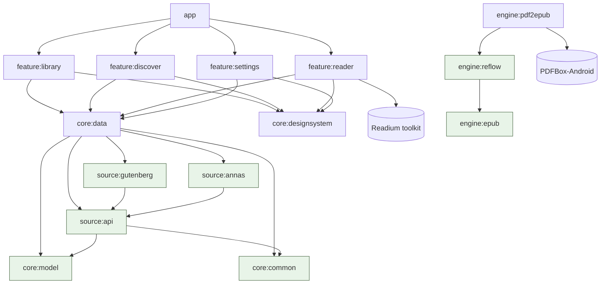

# Architecture

Readana follows the layering of Google's *Now in Android* reference app, trimmed for a solo
project: a thin `app` shell, independent `feature` modules, shared `core` modules, and two groups
that are unique to this app — `engine` (document processing) and `source` (where books come from).

## Module graph



Green nodes are pure Kotlin/JVM modules: no Android dependency, millisecond unit tests, no Robolectric.

| Group | Responsibility | Android? |
|-------|----------------|----------|
| `app` | `ReadanaApplication` (Hilt root), `MainActivity` (FragmentActivity for Readium), `ReadanaApp` (adaptive nav + `NavDisplay`), Konsist tests | yes |
| `feature/*` | One screen family each: `XxxKey` (NavKey), `xxxEntry()` (entry provider), `XxxRoute` (wires ViewModel), `XxxScreen` (stateless UI), `XxxViewModel` | yes |
| `core/data` | Room (`BookEntity`, `BookDao`, `ReadanaDatabase`), DataStore (`SettingsKeys`), repositories, `BookSourceRegistry`, all Hilt modules | yes |
| `core/designsystem` | `ReadanaTheme`, `ReadanaIcons`, `EmptyState`, `LoadingState`, `BookCoverPlaceholder` | yes |
| `core/model` | `Book`, `BookFormat`, `ReadingProgress`, `ReaderSettings`, `SourceSettings`, `DownloadJob` | no |
| `core/common` | `AppResult`/`AppError`, `@Dispatcher`/`@ApplicationScope`, `suspendRunCatching` | no |
| `core/testing` | `MainDispatcherRule`, `FakeBookSource` | no |
| `source/api` | `BookSource`, `SearchQuery/Page/Result`, `DownloadRequest`, `FileNames` | no |
| `source/gutenberg` | Gutendex JSON client | no |
| `source/annas` | HTML search parser, member fast-download API, `MirrorResolver` | no |
| `engine/epub` | `EpubBook` model, `EpubWriter` (EPUB 3.3, epubcheck-validated) | no |
| `engine/reflow` | `PageText` model, `ReflowEngine` heuristics, `EpubAssembler` | no |
| `engine/pdf2epub` | `PdfBoxTextExtractor`, `PdfToEpubConverter` | yes (PDFBox needs a Context) |

## Data flow

### Discover → download → convert → library (M3/M4 target)

```
DiscoverViewModel ── SearchQuery ──▶ BookSourceRegistry ──▶ each BookSource.search()   (parallel, merged)
      │
      └─ download(result) ──▶ source.resolveDownload() ──▶ DownloadRequest
                                   │ requiresBrowser? ──▶ in-app WebView (Anna's slow download)
                                   ▼
                          DownloadWorker (WorkManager, foreground notification)
                                   │ stream to app storage / SAF folder
                                   ▼ if PDF
                          PdfToEpubConverter (IO dispatcher) ──▶ .epub next to the original
                                   ▼
                          LibraryRepository.upsert(Book)  ──▶ Room ──▶ Library screen (Flow)
```

### Read (M2 target)

`ReaderKey(bookId)` → `ReaderViewModel.open()` → `ReadiumPublicationOpener` (AssetRetriever +
PublicationOpener, pdfium for PDFs) → `Publication` → Readium `EpubNavigatorFragment` hosted in
Compose via `AndroidFragment`, with reader settings from DataStore mapped to Readium
`EpubPreferences`; progress is saved as a Readium `Locator` JSON + fraction.

## Cross-cutting decisions

- **State**: ViewModels expose a single `StateFlow<UiState>` (sealed interfaces); screens are
  stateless and previewable. Events flow up as lambdas.
- **DI**: Hilt. Sources are a `Set<BookSource>` multibinding; add a source with one `@IntoSet` provider.
- **Navigation**: Navigation 3 with a `NavBackStack<NavKey>` owned by `ReadanaApp`; the library is
  always the root so system back returns there; the reader hides the navigation suite.
- **Errors**: `AppResult`/`AppError` at every module boundary; UI maps errors to strings.
- **Threading**: injected dispatchers (`@Dispatcher(IO)`), blocking engines (PDFBox, zip) are
  called inside `withContext(io)`.
- **Storage** (ADR 0007): files default to app-specific storage (`getExternalFilesDir`), with an
  optional SAF tree for a user-visible library folder; metadata always in Room.

## Testing strategy

| Layer | Tool | Example |
|-------|------|---------|
| Pure Kotlin | JUnit 4 + kotlin-test | `ReflowEngineTest`, `EpubWriterTest` (+ epubcheck), `AnnasSearchParserTest` |
| HTTP clients | Ktor `MockEngine` + fixtures | `GutendexSourceTest`, `AnnasArchiveSourceTest` (mirror failover) |
| Room | Robolectric in-memory DB + Turbine | `RoomLibraryRepositoryTest` |
| ViewModels | `MainDispatcherRule` + fakes + Turbine | `LibraryViewModelTest`, `DiscoverViewModelTest` |
| Architecture | Konsist | `ArchitectureTest` |
| UI | Compose previews now; Roborazzi screenshot tests planned | — |

## Build logic

`build-logic/convention` defines the plugins used by every module:

| Plugin id | Applies |
|-----------|---------|
| `readana.android.application` | `com.android.application`, SDK levels, Java 17, lint (`checkDependencies`), BuildConfig |
| `readana.android.application.compose` | Compose compiler + BOM + tooling |
| `readana.android.library` | `com.android.library`, SDK levels, lint, resource prefix, test deps |
| `readana.android.library.compose` | library + Compose |
| `readana.android.feature` | library.compose + Hilt + serialization + core/nav/lifecycle deps |
| `readana.android.room` | Room Gradle plugin, KSP, exported schemas |
| `readana.jvm.library` | `org.jetbrains.kotlin.jvm`, Java 17, Android Lint for JVM, test deps |
| `readana.hilt` | KSP + Hilt (Android) or Dagger core (JVM) |

Spotless and detekt are configured once in the root `build.gradle.kts`.
